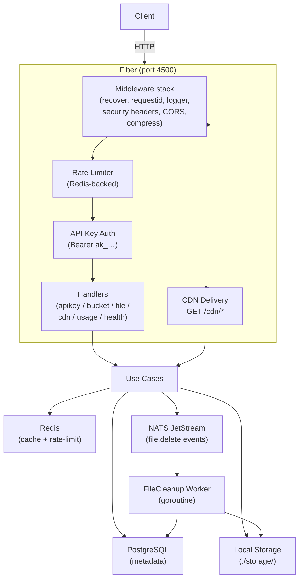

# CDN Network

A self-hosted content delivery backend built with Go and [Fiber v2](https://github.com/gofiber/fiber). It provides an HTTP API for managing storage buckets, uploading files, registering custom CDN domains, and delivering objects through those domains. All binary content is stored on the local filesystem via a custom storage layer; PostgreSQL holds metadata, Redis handles caching and rate-limiting, and NATS JetStream drives asynchronous file-deletion.

> **Status:** Active development. Core file upload, delivery, and CDN-domain management features are implemented. SMTP integration, a `fraud` package, and the `entryPoint.sh` migration runner are stubs or incomplete.

---

## Features

| Feature | Status |
|---|---|
| API key authentication (Bearer `ak_…`) | ✅ Implemented |
| Storage bucket management (create / list / update / delete) | ✅ Implemented |
| Public and private bucket visibility | ✅ Implemented |
| Direct multipart file upload | ✅ Implemented |
| Presigned PUT URL upload (client-direct) | ✅ Implemented |
| File registration + presigned upload complete flow | ✅ Implemented |
| Presigned GET URL for private files (15-minute TTL) | ✅ Implemented |
| Public CDN delivery via `GET /cdn/<object-key>` | ✅ Implemented |
| Custom CDN domain registration and lifecycle | ✅ Implemented |
| Per-bucket CDN settings (TTL, HTTPS enforcement, compression) | ✅ Implemented |
| Redis-backed response caching (files, buckets, domains) | ✅ Implemented |
| Redis-backed distributed rate limiting (fixed-window + penalty box) | ✅ Implemented |
| NATS JetStream async file-deletion worker | ✅ Implemented |
| Structured JSON logging (Zap) | ✅ Implemented |
| Health, liveness, and readiness endpoints | ✅ Implemented |
| Usage event recording and summary | ✅ Implemented |
| Graceful shutdown (15-second window) | ✅ Implemented |
| SMTP email integration | ⚠️ Config present, not wired |
| Fraud detection | ⚠️ Package stub only |
| Automatic TLS / ACME for CDN domains | ❌ Not implemented |
| Domain DNS verification (DNS challenge) | ⚠️ Verification token generated; challenge logic not implemented |

---

## Technology Stack

| Component | Technology | Version |
|---|---|---|
| Language | Go | 1.26 |
| HTTP framework | Fiber v2 | 2.52.15 |
| Database | PostgreSQL (pgx/v5 pool) | ≥ 14 recommended |
| Cache / Rate-limit store | Redis | 8 (Docker image) |
| Messaging | NATS JetStream | 2 (Docker image) |
| Object storage | Local filesystem (custom client) | — |
| Logging | Zap | 1.28 |
| Validation | go-playground/validator | 10.30 |
| Config | godotenv | 1.5 |
| Live reload (dev) | Air | — |
| Reverse proxy (optional) | Nginx | — |

---

## Architecture Overview



The application follows a clean layered architecture:

- **Handlers** parse HTTP input and delegate to use cases.
- **Use cases** contain business logic, coordinate repositories and the storage client, and manage cache.
- **Repositories** execute SQL against PostgreSQL.
- **Infrastructure** packages (`storage`, `redis`, `nats`, `database`, `logger`) wrap external dependencies behind narrow interfaces.
- **Domain packages** (`bucket`, `file`, `cdn`, `apikey`, `usage`) define aggregates, validation rules, and sentinel errors.

---

## Project Structure

```
cdn2.0/
├── cmd/server/main.go          # Application entry point
├── internal/
│   ├── config/                 # Environment variable loading
│   ├── domain/                 # Aggregates and domain errors
│   │   ├── apikey/
│   │   ├── bucket/
│   │   ├── cdn/
│   │   ├── file/
│   │   └── usage/
│   ├── handlers/               # Fiber route handlers
│   ├── health/                 # Health / liveness / readiness
│   ├── infrastructure/
│   │   ├── database/           # PostgreSQL pool
│   │   ├── logger/             # Zap structured logger
│   │   ├── nats/               # NATS JetStream client
│   │   ├── redis/              # Redis client wrapper
│   │   └── storage/            # Local filesystem object store
│   ├── middleware/             # API key auth, rate limiting
│   ├── repos/                  # PostgreSQL repositories
│   ├── routes/                 # Route registration and DI wiring
│   ├── security/
│   │   ├── fraud/              # Stub — not yet implemented
│   │   └── ratelimit/          # Fixed-window + penalty-box limiter
│   ├── usecase/                # Business logic layer
│   ├── utils/                  # Shared validation helpers
│   └── workers/                # NATS JetStream background consumers
├── pkg/
│   ├── cache/                  # Typed Redis cache helpers
│   ├── crypto/                 # Cryptographic utilities
│   ├── errors/                 # Shared sentinel errors
│   └── response/               # Standardised JSON response envelope
├── migrations/                 # golang-migrate SQL files
├── scripts/                    # Shell utility scripts
├── deploy/nginx/               # Example Nginx reverse-proxy config
├── storage/                    # Default runtime storage root (gitignored)
├── logs/                       # Runtime log files (gitignored)
├── Dockerfile                  # Multi-stage build
├── docker-compose.yml          # Postgres + Redis + NATS + API
├── .air.toml                   # Air live-reload config
└── .env.example                # Environment variable template
```

---

## Prerequisites

### Local development
- Go 1.22 or later (`go.mod` declares `go 1.26.0`)
- PostgreSQL ≥ 14
- Redis ≥ 7
- NATS 2 with JetStream enabled (`-js` flag)
- [`golang-migrate`](https://github.com/golang-migrate/migrate) CLI — for running migrations
- [`air`](https://github.com/air-verse/air) (optional) — for live reload

### Docker / containerised
- Docker ≥ 24
- Docker Compose v2

---

## Quick Start

### 1 — Clone and configure

```bash
git clone <repo-url>
cd cdn2.0
cp .env.example .env
# Edit .env — at minimum set POSTGRES_USER, POSTGRES_PASSWORD, POSTGRES_DB,
# REDIS_PASSWORD, STORAGE_SIGNING_SECRET, and STORAGE_PUBLIC_BASE_URL.
```

### 2 — Start infrastructure

```bash
docker compose up postgres redis nats -d
```

### 3 — Create the database

```bash
./scripts/createDB.sh
```

### 4 — Run migrations

```bash
# Requires the golang-migrate CLI:
go install -tags 'postgres' github.com/golang-migrate/migrate/v4/cmd/migrate@latest

./scripts/migrate.sh up
```

### 5 — Start the application

```bash
# With live reload (development):
air

# Without live reload:
go run ./cmd/server
```

### 6 — Create your first API key

```bash
./scripts/createFirstAPIKey.sh
# Prints the raw key — copy it, it is shown only once.
```

### 7 — Verify the installation

```bash
export CDN_KEY="ak_<your-key>"
export BASE="http://localhost:4500/api/v1"

curl -s "$BASE/health" | jq .
curl -s -H "Authorization: Bearer $CDN_KEY" "$BASE/buckets" | jq .
```

---

## Configuration Reference

See [`docs/configuration.md`](docs/configuration.md) for the full reference. Key variables:

| Variable | Required | Default | Description |
|---|---|---|---|
| `APP_ENV` | No | `development` | Set to `production` to enable production validation |
| `APP_PORT` | No | `4500` | HTTP listen port |
| `POSTGRES_USER` | Yes (prod) | — | PostgreSQL username |
| `POSTGRES_PASSWORD` | Yes (prod) | — | PostgreSQL password |
| `POSTGRES_DB` | Yes (prod) | — | PostgreSQL database name |
| `REDIS_HOST` | No | `localhost` | Redis hostname |
| `REDIS_PASSWORD` | No | — | Redis password |
| `NATS_URL` | No | `nats://nats:4222` | NATS connection URL |
| `STORAGE_SIGNING_SECRET` | Yes (prod) | — | HMAC secret for presigned URLs |
| `STORAGE_PUBLIC_BASE_URL` | Yes (prod) | — | Public base URL for CDN delivery |
| `CORS_ALLOWED_ORIGINS` | No | Dev defaults | Comma-separated allowed origins |
| `TRUSTED_PROXIES` | No | — | Comma-separated proxy CIDRs/IPs |

---

## API Overview

All management endpoints are prefixed with `/api/v1` (configurable via `API_PREFIX`) and require `Authorization: Bearer <api-key>`.

| Group | Endpoint | Method |
|---|---|---|
| API Keys | `/api/v1/api-keys` | `POST GET` |
| | `/api/v1/api-keys/:keyId` | `DELETE` |
| Buckets | `/api/v1/buckets` | `POST GET` |
| | `/api/v1/buckets/:bucketId` | `GET PATCH DELETE` |
| Files | `/api/v1/buckets/:bucketId/files` | `POST GET` |
| | `/api/v1/buckets/:bucketId/files/upload` | `POST` |
| | `/api/v1/buckets/:bucketId/files/upload-url` | `POST` |
| | `/api/v1/buckets/:bucketId/files/:fileId` | `GET DELETE` |
| | `/api/v1/buckets/:bucketId/files/:fileId/complete` | `POST` |
| | `/api/v1/buckets/:bucketId/files/:fileId/url` | `GET` |
| CDN Domains | `/api/v1/buckets/:bucketId/cdn-domains` | `POST GET` |
| | `/api/v1/buckets/:bucketId/cdn-domains/:domainId` | `DELETE` |
| | `/api/v1/buckets/:bucketId/cdn-domains/:domainId/verify` | `POST` |
| | `/api/v1/buckets/:bucketId/cdn-domains/:domainId/enable` | `POST` |
| | `/api/v1/buckets/:bucketId/cdn-domains/:domainId/disable` | `POST` |
| CDN Settings | `/api/v1/buckets/:bucketId/cdn-settings` | `GET PUT` |
| Usage Events | `/api/v1/usage-events` | `POST GET` |
| | `/api/v1/usage-events/summary` | `GET` |
| Health | `/api/v1/health` | `GET` |
| | `/api/v1/health/live` | `GET` |
| | `/api/v1/health/ready` | `GET` |
| CDN Delivery | `/cdn/*` | `GET` (no auth) |

Full request/response schemas: [`docs/api-reference.md`](docs/api-reference.md).

---

## Running Tests

```bash
# Unit tests
go test ./...

# With race detector
go test -race ./...

# Specific packages
go test ./internal/domain/...
go test ./internal/security/...
go test ./pkg/...
```

> The `tests/` directory exists but is currently empty. Test files exist in `internal/domain/`, `internal/handlers/`, `internal/infrastructure/storage/`, and `internal/usecase/`.

---

## Docker and Deployment

See [`docs/deployment.md`](docs/deployment.md) for full details.

```bash
# Build and start all services (Postgres, Redis, NATS, API)
docker compose up --build -d

# View logs
docker compose logs -f api

# Stop
docker compose down
```

> ⚠️ `docker compose down -v` removes named volumes and **deletes all stored data**. Do not run this on a system holding data you want to keep.

---

## Security

- API keys are stored as SHA-256 hashes; plaintext is shown only once at creation.
- Rate limiting: 10 req/s API, 5 req/s upload, 25 req/s delivery (per IP, Redis-backed).
- Security headers (`X-Content-Type-Options`, `X-Frame-Options`, `Referrer-Policy`) on every response.
- `X-Forwarded-*` headers are only trusted from explicitly configured proxy IPs/CIDRs (`TRUSTED_PROXIES`).
- 5xx error messages are never exposed to clients.
- Object keys are date-partitioned, UUID-prefixed, and path-traversal-stripped.

See [`docs/security.md`](docs/security.md) and [`SECURITY.md`](SECURITY.md) for more detail.

---

## Known Limitations

- **No DNS challenge verification** — the verification token is generated but the DNS lookup that confirms domain ownership is not implemented. `POST /cdn-domains/:id/verify` marks the domain active without checking DNS.
- **Single-node storage** — files are written to `./storage/` on the running host. There is no replication, no S3/MinIO integration at this time. The `storage` directory must be on a persistent volume in production.
- **No TLS termination** — run behind a reverse proxy (Nginx example in `deploy/nginx/`) for HTTPS.
- **SMTP not wired** — config variables are loaded but no code sends email.
- **Fraud detection** — the `internal/security/fraud` package is an empty stub.

---

## Contributing

See [`CONTRIBUTING.md`](CONTRIBUTING.md).

## License

No license file is present in this repository. All rights reserved by the author unless otherwise stated.
