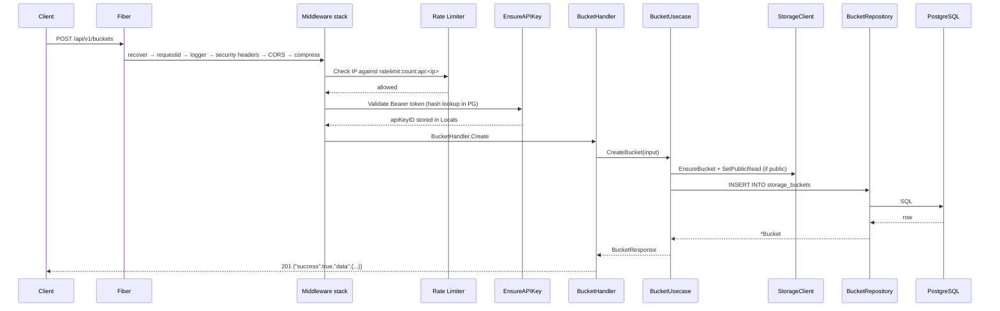
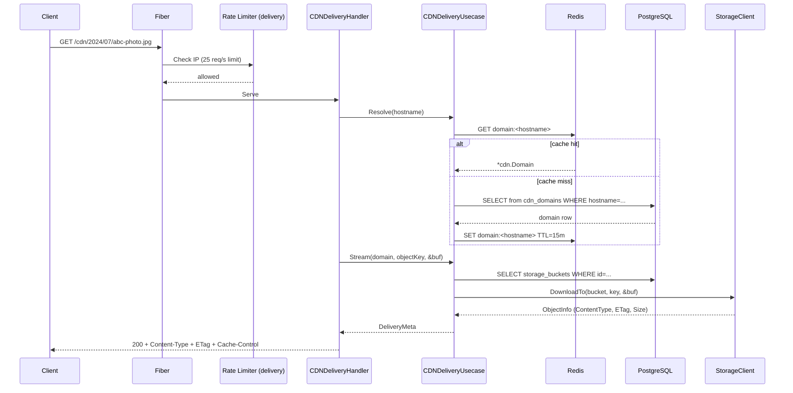

# Architecture

## System Overview

CDN Network is a single-binary Go service that acts as a file-storage and content-delivery backend. Clients interact with it through two surfaces:

1. **Management API** (`/api/v1/…`) — authenticated with API keys; used to create buckets, upload files, and configure CDN domains.
2. **CDN Delivery** (`/cdn/<object-key>`) — unauthenticated; used by browsers and downstream caches to retrieve public objects.

All binary content lives on the **local filesystem** inside a `./storage/` directory tree managed by a custom storage client. Metadata (buckets, files, CDN domains, usage events, API keys) is persisted in **PostgreSQL**. **Redis** provides both a read-through cache layer and the backing store for the distributed rate limiter. **NATS JetStream** carries asynchronous deletion events from the API handler to a background worker.

---

## Component Responsibilities

| Component | Responsibility |
|---|---|
| [`cmd/server/main.go`](../cmd/server/main.go) | Bootstrap: loads config, connects all infrastructure, registers routes, starts Fiber, handles graceful shutdown |
| `internal/config` | Single-pass environment variable loading with defaults |
| `internal/handlers` | HTTP layer — parse input, call use case, format response |
| `internal/usecase` | Business logic — orchestrate repositories, storage, cache |
| `internal/repos` | SQL queries via pgx/v5 pool |
| `internal/domain` | Aggregates, value objects, validation, sentinel errors |
| `internal/infrastructure/storage` | Custom local-filesystem object store |
| `internal/infrastructure/redis` | Redis client wrapper |
| `internal/infrastructure/nats` | NATS JetStream client wrapper |
| `internal/infrastructure/database` | pgx connection pool factory |
| `internal/infrastructure/logger` | Zap logger construction |
| `internal/middleware` | API key authentication, rate-limit middleware |
| `internal/security/ratelimit` | Fixed-window + penalty-box rate limiter (in-memory and Redis backends) |
| `internal/workers` | `FileCleanupWorker` — NATS consumer that deletes objects and updates DB |
| `internal/health` | Health, liveness, and readiness handlers |
| `pkg/cache` | Generic typed Redis helper (Get/Set/Invalidate + key constructors) |
| `pkg/response` | Standardised JSON envelope (`{success, message, data, error}`) |
| `pkg/errors` | Shared sentinel errors |

---

## Request Lifecycle

### Management API request (e.g. `POST /api/v1/buckets`)



### CDN Delivery request (`GET /cdn/<object-key>`)



---

## Package Dependency Graph

```
cmd/server
  └── internal/routes
        ├── internal/handlers/*
        │     └── internal/usecase/*
        │           ├── internal/repos/*
        │           │     └── internal/infrastructure/database
        │           ├── internal/infrastructure/storage
        │           └── pkg/cache
        │                 └── internal/infrastructure/redis
        ├── internal/middleware
        │     └── internal/security/ratelimit
        ├── internal/workers
        │     └── internal/infrastructure/nats
        └── internal/health
```

Domain packages (`internal/domain/*`) have no imports from infrastructure or use cases — they are pure Go with only standard library and `github.com/google/uuid`.

---

## Storage Architecture

The storage client (`internal/infrastructure/storage/storage.go`) is a self-contained local-filesystem object store. It implements the same conceptual interface as an S3-compatible store (buckets, objects, presigned URLs) but writes directly to disk.

### On-disk layout

```
storage/
├── <storage-bucket-name>/       # e.g. b-3a9f1c…
│   ├── 2024/07/uuid-photo.jpg   # object file
│   └── .meta/
│       ├── __bucket__.json      # BucketMeta (visibility, region, createdAt)
│       └── 2024/07/uuid-photo.jpg.json  # ObjectMeta (content-type, etag, …)
```

### Storage bucket names

Storage bucket names are derived deterministically and are not user-controlled:

```go
storageBucketName = "b-" + hex(sha256(apiKeyID + "|" + name + "|" + newUUID))[:20]
```

This produces a 22-character name (`b-` + 20 hex chars) that is globally unique and safe as a filesystem directory name.

### Presigned URLs

Presigned URLs are HMAC-SHA256 signed using `STORAGE_SIGNING_SECRET`. The signature covers `METHOD + bucket + key + expiry-unix-timestamp`. The storage HTTP handler validates the signature and rejects expired URLs.

Presigned PUT URLs expire in 15 minutes. Presigned GET URLs for private files also expire in 15 minutes.

---

## Cache Architecture

Redis caching is performed by the `pkg/cache` package using a generic `Get[T]` / `Set[T]` / `Invalidate` API. Cache keys follow the pattern `<prefix>:<id>`:

| Key | TTL | Invalidated on |
|---|---|---|
| `file:<uuid>` | 5 min | `MarkFileDeleted`, `CompleteUpload` |
| `bucket:<uuid>` | 10 min | — (no explicit invalidation currently) |
| `domain:<hostname>` | 15 min | — (no explicit invalidation currently) |
| `filelist:<bucketId>:<limit>:<offset>` | 5 min | — (no explicit invalidation currently) |

Cache misses fall through to PostgreSQL transparently. Cache failures are logged as warnings and do not fail the request.

---

## Rate Limiting

The rate limiter lives in `internal/security/ratelimit`. Two backends exist:

- **InMemoryStore** — single-process, used in tests.
- **RedisStore** — distributed, used in production via a Lua script for atomic increment + expiry.

Three rate-limit kinds are applied:

| Kind | Window | Max requests | Penalty threshold | Penalty window |
|---|---|---|---|---|
| `api` | 1 s | 10 | 5 violations | 5 min |
| `upload` | 1 s | 5 | 5 violations | 5 min |
| `delivery` | 1 s | 25 | 5 violations | 5 min |

Rate limiting is keyed by client IP. When a client accumulates ≥ 5 violations within the penalty window it is placed in the penalty box and all subsequent requests are rejected until the penalty window expires.

> **Note:** The `upload` kind is defined in configuration but the upload routes are not currently decorated with it separately — they fall under the `api` limiter applied globally to the `/api/v1` group.

---

## Concurrency Model

The application is entirely goroutine-based:

- Fiber runs its own internal goroutine pool for request handling.
- `FileCleanupWorker.Start` blocks on `<-ctx.Done()` and is wrapped in a dedicated goroutine started in `routes.Register`.
- API key `last_used_at` updates are fire-and-forget goroutines.
- Background cleanup of in-memory rate-limit entries runs in a ticker goroutine inside `InMemoryStore`.

---

## Startup Sequence

1. Load `.env` (non-fatal if absent — container deployments inject env vars directly).
2. Build `*config.Config` from environment variables.
3. Initialise Zap logger; write to `logs/app.log` in production, stdout in development.
4. In production mode, validate required credentials (`POSTGRES_*`, `STORAGE_*`) and `log.Fatal` if missing.
5. Connect PostgreSQL (connection pool, ping with 10-second timeout).
6. Connect Redis (ping with 30-second timeout).
7. Connect NATS (5-second connect timeout, JetStream initialisation).
8. Create storage client (creates `./storage/` directory if absent).
9. Construct Fiber app with global middleware (recover, requestid, logger, security headers, CORS, compress).
10. Mount static file server at `/`.
11. Register routes, instantiate all repositories and use cases (dependency injection by hand).
12. Start `FileCleanupWorker` in a goroutine.
13. Fiber listens in a goroutine; `main` waits for `SIGINT`/`SIGTERM` or a server error.
14. On signal: cancel the application context (stops the worker), then call `app.ShutdownWithContext` with a 15-second deadline.

---

## Graceful Shutdown

```
SIGINT / SIGTERM
      │
      ▼
context.CancelFunc() ──► FileCleanupWorker.sub.Unsubscribe()
      │
      ▼
app.ShutdownWithContext(15s) ──► drains in-flight requests
      │
      ▼
deferred Close() calls: psqlClient, redisClient, natsClient, storageClient (no-op)
```

---

## Architectural Decisions and Known Issues

1. **Local filesystem storage** — simplifies deployment (no S3 credentials, no extra service) but means storage is single-node and not replicated. A `storage/` volume mount is required in production.

2. **No cache invalidation on bucket updates** — when a bucket's visibility changes, the `bucket:<id>` cache key is not explicitly deleted. The stale entry will expire after 10 minutes. During that window, `GetFileURL` may return a presigned URL for a bucket that has been made public (or vice versa).

3. **Domain verification is incomplete** — `VerifyDomain` marks the domain `active` without performing any DNS lookup. Any registered hostname can be immediately activated.

4. **`fmt.Println(objectKey)` in CDN handler** — a debug statement in `CDNDeliveryHandler.Serve` (`internal/handlers/cdn_delivery_handler.go:93`) writes raw object keys to stdout. This should be removed before production use.

5. **`entryPoint.sh` is a stub** — the file contains only `echo "▶ Running database migrations..."` with no actual migration invocation. The Docker image does not automatically migrate on start.

6. **`internal/security/fraud`** — the package is declared but contains only a package declaration. No fraud detection logic is implemented.
